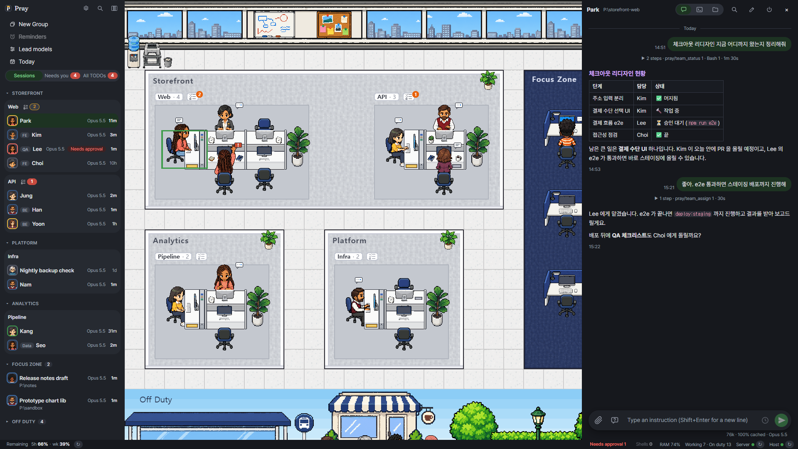
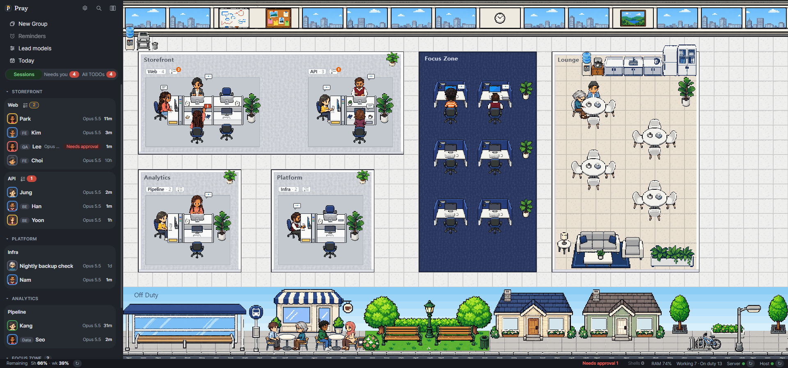
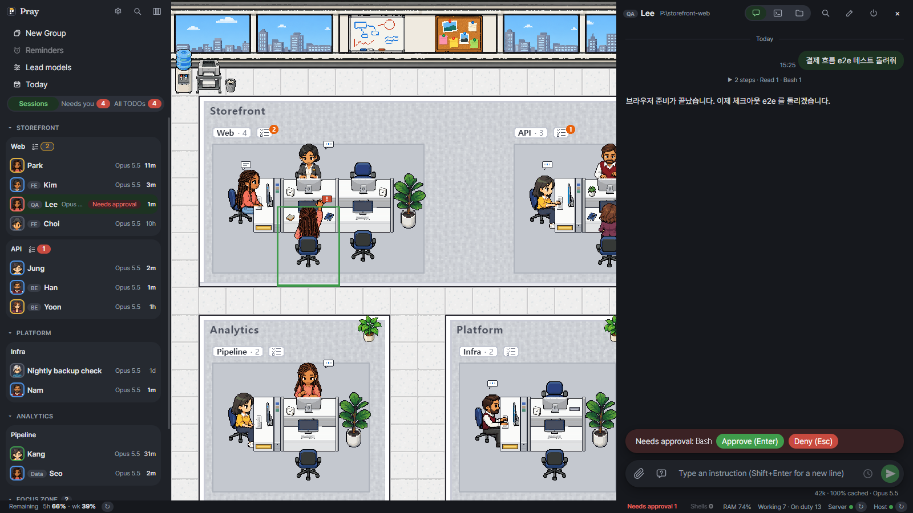
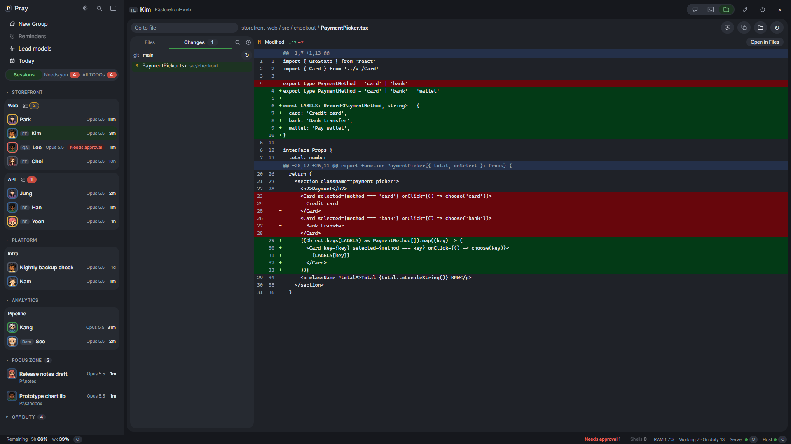
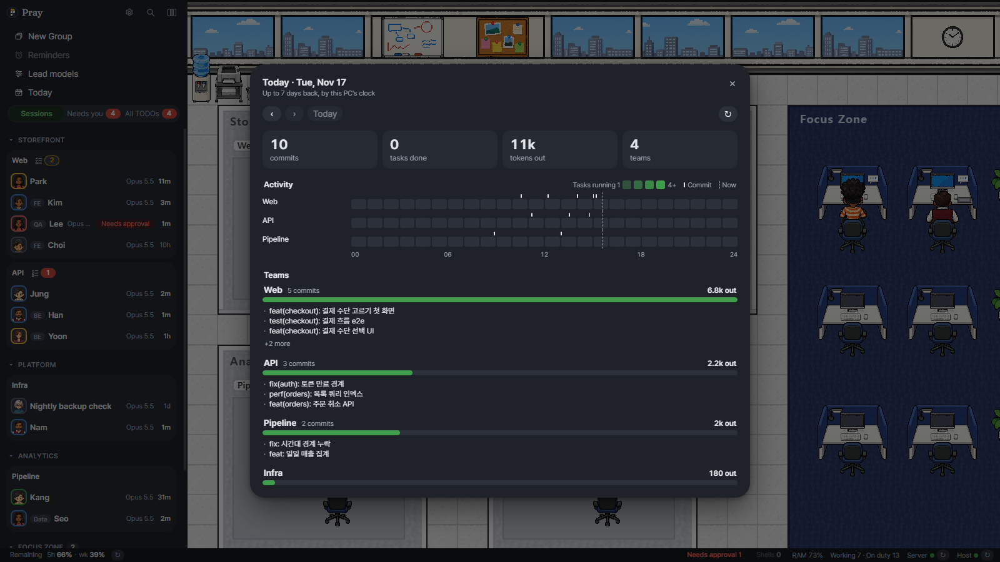
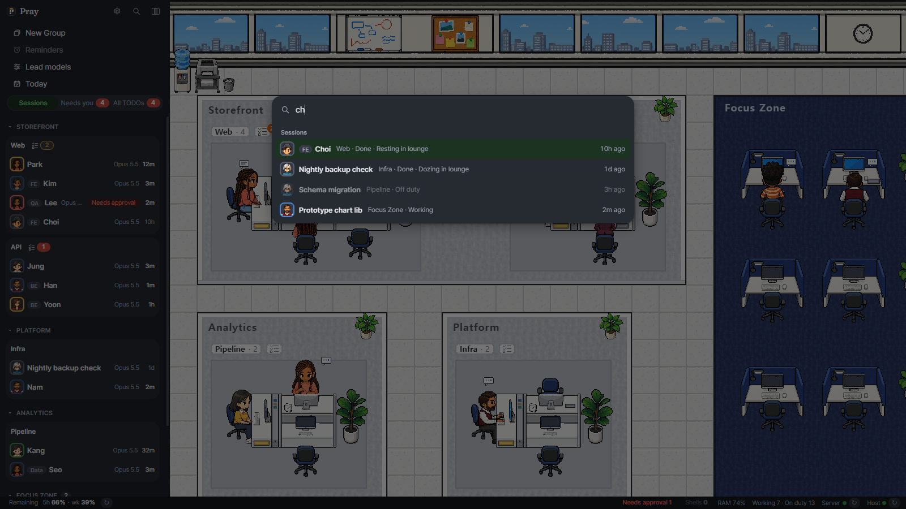
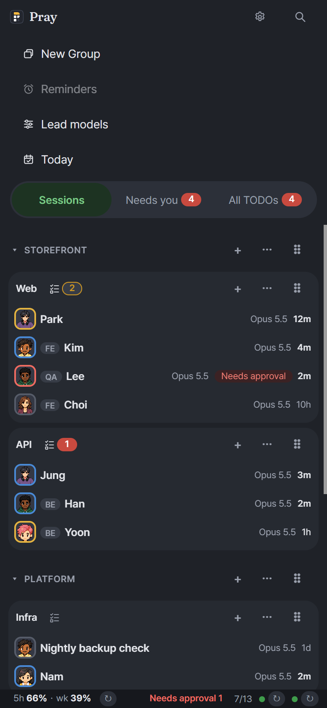
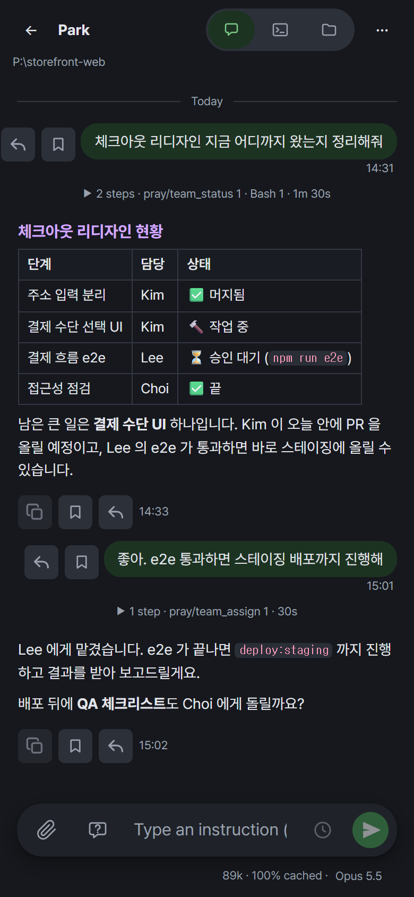

<div align="center">


# Pray

### *Do your best. Then pray.*

**Windows PC 한 대에서 도는 Claude Code 세션 관제판.**<br>
세션 하나하나가 픽셀 사무실의 직원이 되어 일하고, 손을 들고, 쉬고, 퇴근한다.


</div>



<p align="center"><sub>스크린샷은 가짜 데이터로 찍었다.</sub></p>

---

## 왜 Pray 인가

Claude Code 세션을 대여섯 개 넘게 띄우면 터미널 탭 사이를 오가며 "누가 승인을 기다리지?", "누가 끝났지?" 를 찾느라 시간을 쓴다. Pray 는 그 질문에 **한눈에** 답한다.

| | |
|---|---|
| 🏢 **보인다** | 모든 세션(웹·터미널·IDE)이 사무실 책상에 앉아 지금 상태를 몸으로 보여 준다 |
| 🕹️ **조작한다** | 웹에서 띄운 세션은 대화·승인·질문 답·중지·대기 취소·모델 변경까지 화면에서 한다 |
| 👥 **지휘한다** | 팀장 세션이 MCP 도구로 팀원을 띄우고 일을 나눠 주고 결과를 받는다 |
| 🔔 **알려 준다** | 끝나거나, 내 차례거나, 승인을 기다리면 Windows 알림. 누르면 그 세션으로 간다 |

> 에이전트에게 맡기는 개발은 기도와 닮았다 — 할 수 있는 최선을 다한 뒤에 하는 것이다.

---

## ✨ 기능



### 🏢 픽셀 사무실

- **그룹 → 팀 → 세션.** 그룹은 공간, 팀(같은 폴더의 세션 묶음)은 칸막이 섬, 세션은 책상의 사람이다.
- 작업 중이면 타자를 치고, 승인 대기는 손을 들고(빨간 `!`), 오래 쉰 세션은 **Lounge** 로 간다.
- 팀 없는 세션은 **Focus Zone**, 끝난 세션은 **Off Duty** 거리(버스 정류장 → 카페 → 공원 → 집)에 앉는다.
- 창밖과 거리는 PC 시각에 따라 아침·낮·노을·밤으로 바뀐다. 인물·머리색·옷 색은 골라 바꿀 수 있다.
- 세션 순서는 **생성순으로 고정**이다. 일을 해도 줄과 책상이 움직이지 않고 상태는 색 점·배지로 본다.

### 💬 세션 패널

| 탭 | 하는 일 |
|---|---|
| **Chat** | 말풍선 대화(마크다운·코드 복사·그림 미리보기), 도구 호출은 한 줄로 접힘, 보낸 시각·날짜 구분선, 대화 안 검색, 말풍선 마크, 파일 첨부, 다음 입력 제안 ✦, 예약 보내기 ⏰, 곁가지 질문 `/btw` |
| **Terminal** | 실제 터미널(xterm.js). 웹 세션은 그대로 입력할 수 있다 |
| **Files** | 세션 폴더 트리·줄 번호 코드 보기·md 미리보기, git/SVN **Changes** 와 diff, git **History**, 빠른 찾기, 내용 찾기 `Ctrl+Shift+F`, 줄을 골라 **Add to chat**, 이 PC 에서는 CodeMirror 로 편집·저장 |

<table>
<tr>
<td width="50%"></td>
<td width="50%"></td>
</tr>
<tr>
<td align="center"><sub>승인 대기는 손을 들고, 패널 아래 막대에서 <b>Enter / Esc</b> 로 답한다</sub></td>
<td align="center"><sub><b>Files ▸ Changes</b> — 세션이 고친 파일과 diff</sub></td>
</tr>
</table>

- **승인·질문을 화면에서** — 도구 승인 막대(`Enter`/`Esc`)와 `AskUserQuestion` 선택지에 바로 답한다.
- **Stop · Cancel** — 작업 중인 차례를 멈추고, 대기열에 쌓인 마지막 메시지를 뺀다.
- **모델·effort 바꾸기** — 세션을 이어서 다른 모델로 다시 띄운다.
- 작업 파일(scratchpad)과 claude 가 띄운 백그라운드 **Shells** 의 출력을 본다.

### 👥 팀 · 파트 · 팀장

- 팀장 세션에 stdio MCP 서버 `pray` 가 붙는다: `team_spawn_member` · `team_assign` · `team_wait` · `team_status` · `team_dismiss` · `team_remind`.
- **파트**는 팀 안의 작은 지휘 단위이고, git worktree 로 따로 떼어 일할 수 있다.
- 팀장·파트장 문맥이 15만 토큰을 넘으면 **Hand over** — 직전 지시 히스토리를 넘겨받은 새 팀장을 띄운다.
- **Lead models** 창에서 근무 중인 팀장·파트장의 모델을 한꺼번에 바꾼다. **Tasks** 창에서 팀원 task 와 들고 남 기록을 본다.

### 🧭 한눈에 보기

- **Needs you** — 승인 대기·내 차례·끝난 세션만 모아 보기.
- **All TODOs** — 내 책상 할 일과 모든 팀의 남은 할 일.
- **Today** — 그날 팀마다 커밋·끝난 task·출력 토큰·시간대 타임라인 (7일 전까지).
- **Reminders** — 정한 시각에 사람에게 한 번 울리는 알림 (팀장도 `team_remind` 로 건다).
- **Command palette** `Ctrl+K` — 세션·팀·그룹·할 일·알림·명령을 찾아 연다.

<table>
<tr>
<td width="50%"></td>
<td width="50%"></td>
</tr>
<tr>
<td align="center"><sub><b>Today</b> — 오늘 팀마다 무엇을 했는지</sub></td>
<td align="center"><sub><b>Ctrl+K</b> — 어디서든 세션·명령 찾기</sub></td>
</tr>
</table>

### 🪟 트레이 앱

- 호스트·서버를 자식으로 띄우고 죽으면 3초 뒤 다시 띄운다. 창 X 는 숨기기, **Quit 만 진짜 종료**.
- 세션 알림은 그 세션의 도트 인물 얼굴을 달고 뜬다. 승인 대기 세션이 있으면 트레이 아이콘에 빨간 점.
- 화면 아래 상태 표시줄의 `↻` 로 서버·호스트를 재시작한다. 웹 세션은 끊겨도 `--resume` 으로 돌아온다.

### 🔐 그 밖에

- **사용량·계정** — 5시간·주간 한도의 남은 비율, 저장해 둔 여러 Claude 계정 사이 전환(웹에서 로그인 추가).
- **근무·휴식·퇴근** — 호스트 재시작 동안은 휴식, 끝난 웹 세션은 퇴근 기록, **Clock in** 으로 다시 출근.
- **다른 PC·폰에서** — 메일로 받은 6자리 코드로 로그인. 768px 이하는 한 열 화면.
- **테마** — 라이트·다크·시스템, 팔레트·강조색·글자 크기·대화 모양.
- **훅 자동 설치** — 서버가 `~/.claude/settings.json` 에 빠진 훅을 저절로 넣고, 못 넣으면 경고한다.

<p align="center">

&nbsp;&nbsp;

<br><sub>폰에서는 한 열 — 목록에서 세션을 눌러 대화로 들어간다</sub>
</p>

---

## 🚀 시작하기

### 필요한 것

- Windows 10 / 11
- Node.js (개발은 v24) — `node-pty`·Electron 을 쓰므로 npm 이 받는 빌드가 도는 환경
- 설치하고 로그인한 [Claude Code](https://claude.com/claude-code) CLI (`claude.exe` 가 PATH 에)
- *(선택)* Python + numpy·Pillow — `tools/sprites` 로 사무실 그림을 다시 만들 때만

### 설치·실행

```bash
npm install         # postinstall 이 electron.exe 를 Pray 로 브랜딩하고 pray.exe 사본을 만든다
npm run build       # web/dist 생성 (서버가 정적으로 제공)
npm run desktop     # 트레이 앱 실행 → 창에 사무실이 열린다
```

훅은 서버가 시작할 때 `~/.claude/settings.json` 에 넣는다 (기존 훅은 그대로). 서버보다 먼저 넣고 싶으면 `npm run hooks:install`.

브라우저로도 **http://127.0.0.1:4710** 에서 같은 화면을 쓴다. 로그는 `~/.claude/pray/logs/*.log`.

<details>
<summary><b>트레이 메뉴 한눈에</b></summary>

- 클릭 = 창 열기
- 우클릭 = Open · Notifications · Launch at login · Troubleshoot ▸ (호스트·서버 상태 · 버전 · Restart server · Restart host… · Restart Pray… · Open log folder) · Quit
- 호스트·서버가 꺼져 있으면 맨 위에 `⚠ Server stopped`, 훅을 못 넣었으면 `⚠ Pray hooks missing · Try again`
- 시작 메뉴·작업 표시줄·로그인 자동 실행 바로가기는 `pray.exe "<저장소>\desktop"` 이고, 트레이가 1분마다 인자가 빠지지 않았는지 지킨다

</details>

<details>
<summary><b>설치판 만들기 (선택)</b></summary>

저장소 없이 돌아가는 NSIS 설치 파일도 만들 수 있다. 서명은 없어서 처음 설치 때 SmartScreen 경고가 뜬다.

```bash
npm run package     # release/dist/Pray-Setup-<버전>.exe
```

`desktop/package.json` 의 version 을 올리고 같은 이름의 태그(`v0.2.0`)를 push 하면 GitHub Actions 가 Releases 에 올린다. 설치판은 새 버전을 뒤에서 받고 트레이 메뉴 **Restart to update** 로 적용한다. 설치판의 코드는 릴리스해야 바뀌므로, 개발 중에는 저장소 실행(`npm run desktop`)이나 Troubleshoot ▸ **Run host & server from source…** 를 쓴다.

</details>

<details>
<summary><b>대안: 작업 스케줄러</b></summary>

트레이 앱 없이 로그인 때 띄우려면 `npm run startup:install` (`pray-host`·`pray-server` 작업, 관리자 권한). 멈출 때는 `scripts/stop.ps1`, 제거는 `npm run startup:uninstall`. **트레이 앱과 같이 쓰면 포트·pipe 가 충돌한다.**

</details>

---

## ⚙️ 설정 (선택)

설정이 없으면 127.0.0.1 전용·메일 로그인 없음으로 뜬다. 다른 PC 에서 들어오려면 `~/.claude/pray/config.json` 을 만든다 (저장소 밖. SMTP 비밀번호가 들어가니 커밋·출력하지 않는다).

```json
{
  "bind": "0.0.0.0",
  "loginEmails": ["..."],
  "smtp": { "host": "...", "port": 587, "user": "...", "pass": "..." }
}
```

다른 PC 에서 `http://<이 PC IP 또는 PC 이름>:4710` → 메일 주소 → 6자리 코드(10분, 5회) → 30일 쿠키. Windows 방화벽이 `node.exe` 인바운드를 막으면 첫 접속 때 허용한다.

---

## ⚠️ 알아 둘 것

- **클라우드 서비스가 아니다.** 이 PC 에서만 돌고, HTTP·Secure 없는 쿠키라 **사내망 전제**다. 인터넷에 직접 열지 않는다.
- **터미널·IDE 세션은 관찰만** 한다 (입력·승인·종료를 대신하지 않는다). Claude Code 를 대체하지 않고 그 위에 얹는 화면이다.
- **계정 전환은 이 PC 의 모든 claude 에 적용된다.** 최근에 쓴 세션은 다음 차례에 캐시를 다시 써서 한도를 더 쓴다. 전환 전에 영향받는 세션을 보여 준다.
- 사용량은 `/usage` 와 같은 데이터지만 **비공식 API** 라 언제든 바뀔 수 있다.
- 다음 입력 제안은 Claude Code 의 mod API(early access)로 얻는다. 깨지면 제안만 안 뜨고 나머지는 그대로다.
- 훅은 non-blocking 이라 서버가 꺼져 있어도 Claude Code 에는 영향이 없다 (그동안 상태만 못 받는다).
- **Claude Code 세션 안에서 호스트를 띄우지 않는다.** 중첩 실행으로 판단해 자식 claude 가 바로 끝난다.

---

## 🧱 구조

```
 ┌──────────── desktop (Electron 트레이) ────────────┐
 │   창 · 알림 · 자식 재시작                          │
 │      │                         │                  │
 │      ▼                         ▼                  │
 │   host  ◀── \\.\pipe\pray-host ──▶  server :4710  │◀── web (React + PixiJS)
 │   node-pty → claude.exe              Express·SSE   │◀── Claude Code http 훅
 └───────────────────────────────────────────────────┘
          ▲ mod (웹 세션 전용)           ▲ mcp (팀장 세션의 team_* 도구)
```

| 경로 | 역할 |
|---|---|
| `host/` | named pipe 서버. node-pty 로 claude 를 띄우고 출력을 중계, `hq.json`·퇴근 기록 관리 |
| `server/` | Express. 세션 목록·훅 수신·SSE·팀/할 일/알림/예약 API·Files 탭·사용량·계정 |
| `web/` | React + PixiJS 8 화면 (목록·사무실·대화·터미널·Files) |
| `desktop/` | Electron 트레이 앱. 호스트·서버를 자식으로 띄우고 지키며, 알림을 띄운다 |
| `mcp/` | 팀장·파트장 세션에 붙는 stdio MCP 서버 |
| `mod/` | 웹 세션에만 불러오는 Claude Code mod (입력 제안·대기 취소·곁가지 질문) |
| `hooks/` | `settings.json` 훅 설치 명령 |
| `scripts/` | 트레이 실행·브랜딩·설치 파일 만들기·작업 스케줄러·headless 스크린샷 |
| `tools/sprites/` | 사무실 도트 스프라이트 파이프라인 (Python) |
| `docs/plans/` | 설계 문서 |

---

## 🛠️ 개발

```bash
npm run dev:web     # http://localhost:4711 (Vite, /api 는 4710 으로 프록시)
npm test            # host · server · mcp · web · desktop 의 vitest
npm run shot -- http://127.0.0.1:4710 --out a.png   # headless 화면 캡처
```

- 화면만 고칠 때는 트레이의 호스트·서버를 그대로 두고 `npm run dev:web` 만 띄운다.
- 서버·호스트 코드를 고쳤으면 상태 표시줄 `↻` 나 트레이 메뉴의 재시작으로 반영한다. `desktop/src` 를 고쳤으면 `npm run build --workspace desktop` 뒤 Restart Pray.
- 설계는 [`docs/plans/`](docs/plans/), 영역별 규칙·함정·확인 방법은 [`CLAUDE.md`](CLAUDE.md) 와 `.claude/rules/` 에 있다.

<div align="center">
<br>
<sub>로고는 책상 섬 — 금색 팀장 막대와 흰 책상 셋 — 이 선 P 로 읽히는 마크다.</sub>
</div>
