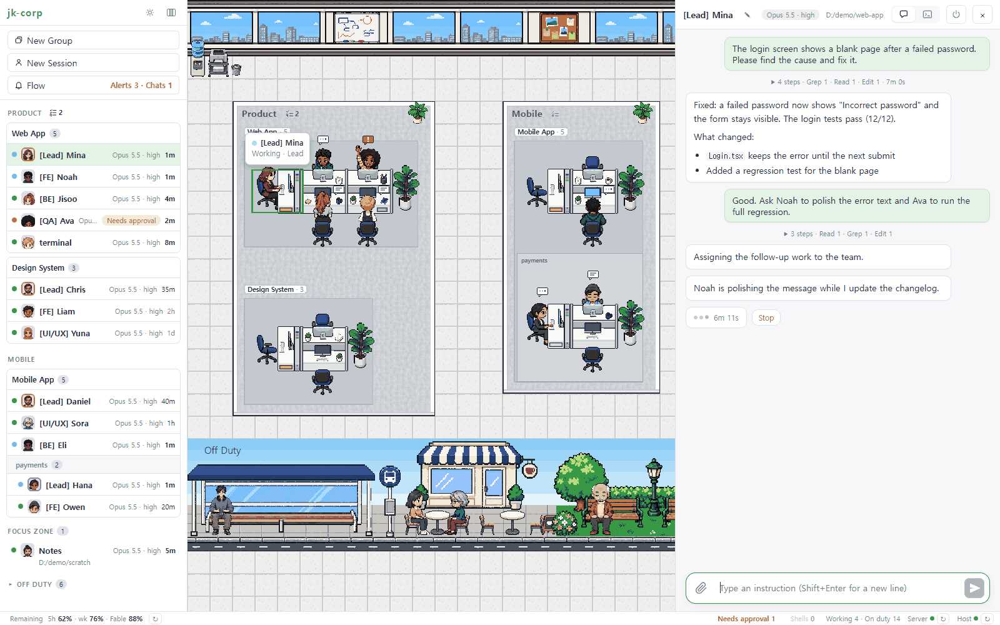
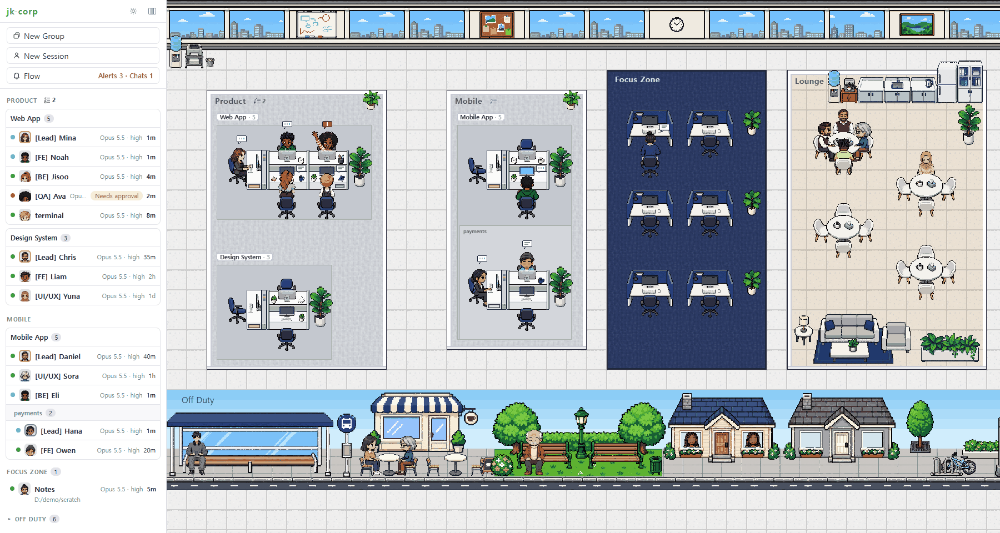

#  Pray

*Do your best. Then pray.*

Windows PC에서 돌아가는 **Claude Code 세션 관제판**. 세션을 픽셀 사무실의 직원으로 보여 주고, 웹에서 띄운 세션은 조작하고 터미널·IDE 에서 띄운 세션은 관찰만 한다.



> 스크린샷은 가짜 데이터로 찍었다.

앱 이름은 Pray 이고, 저장소·패키지·설정 폴더(`~/.claude/jk-corp/`)·pipe 같은 내부 이름은 jk-corp 그대로다. 로고는 책상 섬(금색 팀장 막대 + 흰 책상 셋)이 선 P 로 읽히는 마크다. 에이전트에게 맡기는 개발은 기도와 닮았다 — 할 수 있는 최선을 다한 뒤에 하는 것이라는 뜻이다.

하지 않는 것: 클라우드 서비스가 아니다 (이 PC 에서만 돈다). 터미널·IDE 세션은 입력·승인·종료를 대신하지 못한다. Claude Code 를 대체하지 않고 그 위에 얹는 화면이다.

## 주요 기능



- **사무실** — 그룹은 공간, 팀(같은 폴더의 세션 묶음)은 칸막이 섬, 세션은 책상에 앉은 사람이다. 작업 중이면 타자를 치고, 승인 대기는 손을 들며(빨간 "!"), 차례가 끝난 지 30분이 넘으면 **Lounge** 로 쉬러 간다. 팀 없는 세션은 **Focus Zone**, 끝난 세션은 아래 **Off Duty** 거리(버스 정류장 → 카페 → 공원 → 집)에 앉는다. 창밖과 거리는 PC 시각(아침·낮·노을·밤)에 따라 바뀐다. 휠로 확대·축소, 빈 곳을 끌어 이동한다.
- **대화 탭·터미널 탭** — 말풍선 대화(마크다운, 도구 호출은 한 줄로 접힘)와 실제 터미널(xterm.js). 파일 첨부, 다음 입력 제안(✦)을 지원한다.
- **승인·질문 웹 응답** — 도구 승인과 `AskUserQuestion` 질문을 화면에서 바로 답한다.
- **작업 중지·대기 메시지 취소** — 작업 중인 차례를 [Stop] 으로 멈추고, 대기열에 쌓인 마지막 메시지를 [Cancel] 로 뺀다.
- **팀·파트·팀장** — 팀장 세션에 MCP 도구(`jk_spawn_member`·`jk_assign`·`jk_wait`·`jk_status`·`jk_dismiss`)가 붙어 팀원을 직접 띄우고, 지시하고, 결과를 받는다. 파트는 팀 안의 작은 지휘 단위이고 git worktree 로 분리할 수 있다.
- **사용량·계정 전환** — 화면 아래에 5시간·주간 한도의 남은 비율을 보이고, 저장해 둔 여러 Claude 계정 사이를 전환한다 (웹에서 로그인 추가).
- **근무·휴식·퇴근** — 호스트가 재시작되는 동안은 휴식, 끝난 웹 세션은 퇴근 기록으로 남고 **Clock in** 으로 `--resume` 해 다시 출근한다.
- **작업 파일·백그라운드 shell** — 세션의 scratchpad 파일 미리보기, claude 가 띄운 백그라운드 명령의 출력을 본다.
- **그룹 TODO** — 그룹마다 할 일 목록을 두고 끌어서 순서를 바꾼다.
- **플로우 알림** — flow.team 의 안 읽은 알림·채팅 수를 보이고 알림을 읽음 처리한다.
- **다른 PC 접속** — 메일로 받은 6자리 코드로 로그인한다.
- **폰 화면** — 768px 이하는 한 열로 바뀐다 (사무실은 띄우지 않는다).
- **라이트·다크 테마** — 헤더 버튼으로 라이트 → 다크 → 시스템을 돌린다.

## 필요한 것

- Windows 10/11
- Node.js — 개발에 쓴 버전은 v24 이다. `engines` 제한은 없다. `node-pty`·Electron 을 쓰므로 npm 이 받는 빌드가 돌아가는 환경이 필요하다.
- 설치하고 로그인한 [Claude Code](https://claude.com/claude-code) CLI (`claude.exe` 가 PATH 에 있어야 한다)
- (선택) Python + numpy·Pillow — `tools/sprites` 로 사무실 그림을 다시 만들 때만 필요하다. 평소 실행에는 필요 없다.

## 설치·실행

```
npm install
npm run hooks:install   # ~/.claude/settings.json 에 http 훅 7개를 추가한다 (한 번만. 기존 훅은 건드리지 않는다)
npm run build           # web/dist 생성. 서버가 이걸 정적으로 제공한다
npm run desktop         # 트레이 앱 실행
```

`npm run desktop` 이 호스트(세션을 실제로 띄우는 프로세스)와 서버를 자식으로 띄우고 창에 사무실을 연다. 평소에는 이 트레이 앱으로 쓴다.

- 트레이 아이콘 클릭 = 창 열기, 우클릭 = 상태·Restart server·Restart host·Open log folder·Launch at login·Quit
- **창의 X 는 숨기기일 뿐이다.** 진짜 종료는 트레이의 **Quit** 뿐이다 (호스트가 꺼져 웹 세션이 끊기고, 다음 실행 때 `--resume` 한다).
- 승인 대기 세션이 있으면 트레이 아이콘에 빨간 점이 뜬다.
- 트레이 창 새로고침은 **Ctrl+R** 이다 (F5 아님).
- 브라우저로도 `http://127.0.0.1:4710` 에서 같은 화면을 쓴다.
- 로그: `~/.claude/jk-corp/logs/*.log`

**대안: 작업 스케줄러.** 트레이 앱 없이 로그인 때 자동으로 띄우려면 `npm run startup:install` (`jk-corp-host`·`jk-corp-server` 작업 등록, 관리자 권한 필요). 멈출 때는 `scripts/stop.ps1`, 제거는 `npm run startup:uninstall`. **트레이 앱과 같이 쓰면 포트·pipe 가 충돌한다.**

## 설정 (선택)

설정이 없어도 동작한다 (127.0.0.1 전용, 메일 로그인 없음).

`~/.claude/jk-corp/config.json` — 저장소 밖에 둔다. SMTP 비밀번호가 들어가므로 커밋하거나 출력하지 않는다.

```json
{
  "bind": "0.0.0.0",
  "loginEmails": ["..."],
  "smtp": { "host": "...", "port": 587, "user": "...", "pass": "..." }
}
```

`bind` 를 `0.0.0.0` 으로 하고 `loginEmails` 에 허용할 메일 주소를 넣으면 다른 PC 에서 `http://<이 PC IP>:4710` 으로 접속해 메일 주소 → 6자리 코드(10분, 5회) → 30일 쿠키로 로그인한다. Windows 방화벽이 `node.exe` 인바운드를 막으면 첫 접속 때 허용해야 한다.

플로우 알림: `~/.claude/flow-key.env` 에 `FLOW_API_KEY=` 줄을 넣는다 (값은 플로우에서 발급한 API 키). 파일을 바꾸면 재시작 없이 반영된다.

## 주의

- `npm run hooks:install` 은 `~/.claude/settings.json` 에 훅을 추가한다. 기존 훅은 그대로 둔다. 서버가 꺼져 있으면 훅은 조용히 실패하고 Claude Code 에는 영향이 없다.
- **계정 전환은 이 PC 의 모든 claude(웹·터미널·IDE)에 적용된다.** 최근 1시간 안에 쓴 세션은 다음 차례에 대화 전체를 새 계정으로 다시 캐시에 쓰므로 한도를 더 쓰고 첫 응답이 느리다. 전환 전에 영향을 받는 세션을 화면이 보여 준다.
- 사용량은 Claude Code 의 `/usage` 와 같은 데이터이지만 **비공식 API** 라서 언제든 바뀔 수 있다.
- 다음 입력 제안은 Claude Code 의 mod API(early access)로 얻는다. Claude Code 업데이트로 깨지면 제안 버튼·말풍선만 안 뜨고 나머지는 그대로다.
- HTTP 이고 쿠키에 Secure 가 없다. **사내망 전제**이다. 인터넷에 직접 열지 않는다.
- **Claude Code 세션 안에서 호스트를 띄우지 않는다.** 중첩 실행으로 판단해 자식 claude 가 바로 종료된다.

## 구조

| 경로 | 역할 |
|---|---|
| `host/` | named pipe 서버. node-pty 로 claude 를 띄우고 출력을 중계한다. 퇴근 기록·`hq.json` 도 관리한다 |
| `server/` | Express. 세션 목록·훅 수신·SSE·그룹/팀/TODO API·사용량·계정·플로우 |
| `web/` | React + PixiJS 8 화면 (목록·사무실·대화·터미널) |
| `desktop/` | Electron 트레이 앱. 호스트·서버를 자식으로 띄우고 죽으면 다시 띄운다 |
| `mcp/` | 팀장 세션에 붙는 stdio MCP 서버 (팀원 spawn·지시·결과 받기) |
| `mod/` | 웹 세션에만 불러오는 Claude Code mod (다음 입력 제안·대기 메시지 취소) |
| `hooks/` | `settings.json` 훅 설치 스크립트 |
| `scripts/` | 작업 스케줄러 등록·중지·제거 (PowerShell) |
| `tools/sprites/` | 사무실 도트 스프라이트 생성 파이프라인 (Python) |
| `docs/plans/` | 설계 문서 |

## 개발

```
npm run dev:web   # http://localhost:4711 (Vite). /api 는 4710 으로 프록시
npm test          # host·server·mcp·web 의 vitest
```

- 화면만 고칠 때는 트레이 앱(또는 스케줄러)의 호스트·서버는 그대로 두고 `npm run dev:web` 만 띄운다.
- 서버·호스트 코드를 고쳤으면 트레이 메뉴의 Restart server·Restart host 로 반영한다.
- 설계 문서는 [`docs/plans/`](docs/plans/), 기능별 규칙·함정·확인 방법은 [`CLAUDE.md`](CLAUDE.md) 에 있다.
